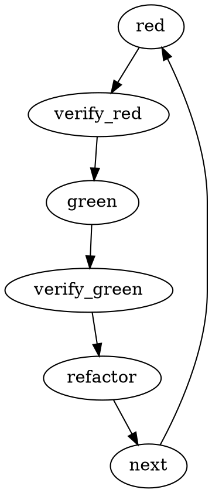

# TDD — Details (Reference)

## Dot Graph

RED = failing deftest, GREEN = minimal defn, REFACTOR = clean.

## Good vs Bad deftest
Good: clear name `create-order-rejects-empty-email`, tests public defn, one thing.
Bad: `create-order-works` with mock-db, tests mock internals.

## Verify Steps
RED verify: `bb test -n app.orders-test` must fail with expected message, not Exception. Pass? fix test. Error? fix require.
GREEN verify: same must pass + other ns still pass + `clj-kondo --lint src` clean.

## Common Rationalizations
"Too simple to test" → breaks. "Test after" → never fails correctly. "Manual REPL tested" → no record. "Delete is wasteful" → sunk cost. "Keep as reference" → adapt = testing after. "Explore first" → throwaway ns then TDD. "TDD slows me" → catches bugs early.

## Red Flags — STOP
Code before deftest, deftest passes immediately, can't explain failure, tests added later, "keep as reference", "TDD dogmatic".

## Example: Empty email bug
RED `(is (= {:error :email-required} (orders/validate {:email ""})))` → FAIL. GREEN add blank check → PASS. REFACTOR extract helper.

## Verification Checklist
- [ ] Every public defn has deftest at ns seam, watched fail
- [ ] Failed for expected reason, minimal defn
- [ ] All deftest pass, kondo clean, real ns API (with-redefs only for port/DB)
- [ ] Edge cases covered

## When Stuck
Don't know how to test → wish-for API in test/, is first. Too complicated → simplify ns, deepen. Must redef everything → inject arg/protocol. Huge setup → test helpers, SQLite in-memory.
