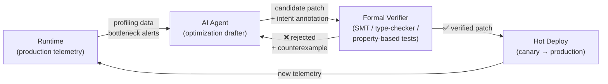

# The Self-Healing Code Thesis: Compilers, AI, and the Next 10 Years of Software

*Can a compiler become smart enough to read your messy code and swap it for a blazing-fast, provably correct algorithm? We've been asking this question for fifty years. The answer is no — but the question itself is wrong. The real future isn't a smarter compiler or a smarter AI. It's the feedback loop between them.*

---

## 1. The Mathematical Wall

There is a long-held folklore belief in computer science:

> *"A sufficiently smart compiler understands the algorithms inside your code and swaps them for faster, native, target-tailored implementations that are provably equivalent."*

This belief crashes into a hard mathematical barrier.

**Rice's Theorem (1953)** proves that *all* non-trivial semantic properties of programs written in Turing-complete languages are undecidable [1]. A compiler cannot, in general, determine what an arbitrary program *means* — let alone replace it with something faster that means the same thing.

What compilers *actually* do is narrower and more honest:

- **GCC / LLVM** optimize within a fixed algorithm: loop unrolling, instruction scheduling, vectorization, register allocation, constant folding, dead code elimination.
- **MLIR / XLA** rewrite tensor computation graphs for specific hardware targets (GPUs, TPUs) — but they operate on a *declared* computation graph, not inferred intent.
- **Superoptimizers** (like Stanford's STOKE [2]) exhaustively search for optimal instruction sequences for *small* code fragments — typically ≤20 instructions. They prove equivalence via SMT solvers, but the search space explodes combinatorially beyond micro-kernels.
- **Futamura Projections (1971)** [3] show that specializing an interpreter with respect to a fixed program can produce a compiler — but this is *partial evaluation*, not algorithm discovery.

The gap is clear: compilers excel at **local**, **syntax-level** optimization. They do not perform **semantic leaps** — recognizing that a nested loop implements a sort and replacing it with a fundamentally different algorithm.

---

## 2. Head-to-Head: Compiler vs. AI

| Dimension | Compiler (Formal) | AI Transformer (Statistical) |
|---|---|---|
| **Core engine** | Type theory, static analysis, SMT solvers, abstract interpretation | Probabilistic sequence modeling, attention, learned representations |
| **Handling intent** | Literal: operates on syntax and declared semantics | Semantic: infers intent from context, comments, naming, patterns |
| **Algorithm discovery** | None beyond pattern-matched idioms (e.g., `memcpy` recognition). Cannot leap from O(N²) → O(N log N). | Can suggest algorithmic upgrades by recognizing high-level patterns across its training corpus |
| **Correctness guarantee** | **Sound.** If it compiles, the transform preserves semantics. | **Probabilistic.** Can hallucinate, introduce subtle bugs, or violate invariants the training data didn't cover |
| **Brittleness** | Fragile against obfuscated, non-idiomatic, or aliased code | Robust against messy human code — but fragile against adversarial or out-of-distribution inputs |

Neither alone is sufficient. Compilers cannot *imagine*. AI cannot *prove*.

---

## 3. Case Study: The Algorithm Leap GCC Cannot Make

Consider a textbook bubble sort in C:

```c
void bubble_sort(int arr[], size_t n) {
    for (size_t i = 0; i < n - 1; i++)
        for (size_t j = 0; j < n - i - 1; j++)
            if (arr[j] > arr[j + 1]) {
                int tmp = arr[j];
                arr[j] = arr[j + 1];
                arr[j + 1] = tmp;
            }
}
```

### What GCC -O3 produces (x86_64, GCC 12.2)

```asm
bubble_sort:
    cmpq    $1, %rsi
    je      .L1
    leaq    -4(%rdi,%rsi,4), %r8
.L5:                            ; outer loop — still O(N) iterations
    movq    %rdi, %rax
.L4:                            ; inner loop — still O(N-i) iterations
    movq    (%rax), %xmm0      ; SSE: load arr[j] and arr[j+1] as 64-bit pair
    pshufd  $0xe5, %xmm0, %xmm1
    movd    %xmm0, %ecx
    movd    %xmm1, %edx
    cmpl    %edx, %ecx          ; compare
    jle     .L3
    pshufd  $225, %xmm0, %xmm0  ; shuffle = swap the pair
    movq    %xmm0, (%rax)       ; store swapped pair
.L3:
    addq    $4, %rax
    cmpq    %rax, %r8
    jne     .L4                  ; inner loop continues
    subq    $1, %rsi
    subq    $4, %r8
    cmpq    $1, %rsi
    jne     .L5                  ; outer loop continues
.L1:
    ret
```

GCC's optimizer is *impressive* at the micro level: it uses SSE registers to load both elements as a 64-bit pair, performs the comparison with scalar ops, and swaps via `pshufd` — eliminating the branch and temporary variable. But the **two nested loops remain**. The algorithm is still **O(N²)**.

### What an AI suggests

An AI code assistant (Copilot, AlphaCode [4], or Claude) recognizes the *intent* — "this sorts an array" — and suggests:

```c
#include <stdlib.h>

int cmp(const void *a, const void *b) {
    return (*(int*)a - *(int*)b);
}

void sort(int arr[], size_t n) {
    qsort(arr, n, sizeof(int), cmp);  // O(N log N) average
}
```

Or, for guaranteed O(N log N) worst-case, a merge sort implementation. The AI makes a **semantic leap** that no compiler can: it recognizes the algorithm's *purpose* and replaces the entire approach.

**The catch:** the AI's suggestion is *probabilistic*. It could introduce an integer overflow bug in the comparator (`*(int*)a - *(int*)b` wraps on `INT_MIN`). A compiler-verified transform would never have that risk — but a compiler would also never make the leap.

This is the fundamental tension.

---

## 4. The Self-Healing Code Thesis

The future is neither a lone "sufficiently smart compiler" nor unchecked AI generation. It is a **closed-loop system** where AI proposes and formal methods dispose.

### The Feedback Loop



Each component exists today. The thesis is that **connecting them into a continuous loop** creates self-healing software: systems that detect their own performance regressions, draft fixes, prove them safe, and deploy them — without human intervention for the common cases.

### The Pieces Already Exist

Five real-world systems demonstrate that each stage of this loop is operational:

**1. Runtime → AI: Production profiling drives optimization**
- **Google AutoFDO** [5] collects hardware performance counter samples from production binaries and feeds them back into the compiler to guide inlining, block placement, and register allocation — a continuous profile-guided optimization loop that runs without developer intervention.

**2. AI → Patch: Automated code repair at scale**
- **Meta SapFix (2018)** [6] automatically generates patches for bugs detected by the Sapienz testing system. At Meta's scale, SapFix produced fixes that were reviewed and shipped to production, handling hundreds of crashes in Android apps. It uses a combination of template-based and mutation-based strategies — the AI drafter of the loop.
- **AWS CodeGuru / Amazon Q Developer** [7] uses ML models trained on Amazon's internal codebase and open-source repositories to flag performance anti-patterns (e.g., excessive object creation in hot loops, sub-optimal AWS SDK usage) and suggest concrete fixes during code review.

**3. Patch → Verification: Formal proof of compiler transforms**
- **Alive2** [8] (Lopes et al.) formally verifies LLVM's peephole optimizations by encoding source and target IR in SMT and proving semantic equivalence. It has found over 50 bugs in LLVM's optimizer — transforms the compiler *thought* were correct but weren't. This is the verifier node.
- **Intel's ACL2-based verification** and **AMD's RTL model checking** [9] apply formal methods to prove correctness of CPU microarchitecture — demonstrating that formal verification scales to billion-transistor designs when the property language is well-scoped.

**4. Verification → Deploy: JIT with profile feedback**
- **GraalVM / HotSpot JIT** [10] already implements a mini version of this loop: it profiles running code, speculatively optimizes hot paths, and *deoptimizes* (falls back to interpreted code) when speculative assumptions are violated. The loop runs continuously at millisecond granularity.

### The Timeline

Here is where I stake a claim:

| Milestone | By When | What It Looks Like |
|---|---|---|
| **AI-drafted micro-optimizations with formal verification** | **2027** | AI suggests peephole-level optimizations (loop interchange, strength reduction); SMT solvers verify equivalence automatically. Integrated into LLVM/GCC as an optional pass. Early versions already prototyped in research (STOKE [2], Alive2 [8]). |
| **Continuous AI + compiler co-optimization in CI/CD** | **2029** | Production profiling data feeds an AI agent that proposes optimizations as pull requests. Each PR is formally verified (property-based tests + SMT) and auto-merged if green. Human review only for algorithmic-level changes. AutoFDO + SapFix + Alive2, unified. |
| **Self-healing runtimes for stateless services** | **2031** | Stateless microservices (HTTP handlers, data pipelines) run a local optimization loop: runtime profiles → AI agent drafts a patch → formal verifier checks it → canary deploy → rollback if regression. No human in the loop for performance fixes. GraalVM-style deoptimization as the safety net. |
| **Algorithmic-level self-healing with proof assistants** | **2034** | AI proposes algorithmic changes (not just instruction-level), generates a proof of correctness in Lean 4 or Coq, and the proof is machine-checked before deployment. The "sufficiently smart compiler" dream — but achieved through AI + formal methods, not a compiler alone. |

Each milestone builds on the previous one. The 2027 target is conservative — the components exist. The 2034 target is ambitious — it requires AI that can generate machine-checkable proofs, which is an active research frontier (see autoformalization efforts in Lean [11]).

---

## 5. Conclusion

The "sufficiently smart compiler" was always a thought experiment about a tool that doesn't exist and mathematically cannot exist in its full generality. Rice's theorem closes that door.

But the *desire* behind the thought experiment — software that automatically gets faster, safer, and more correct — is achievable through a different architecture: the closed feedback loop of runtime profiling, AI-drafted optimization, formal verification, and automated deployment.

The compiler provides the **proof**. The AI provides the **leap**. The runtime provides the **signal**. Connected in a loop, they build something neither could alone: software that heals itself.

By 2031, your stateless services will optimize themselves overnight. By 2034, they'll rewrite their own algorithms and prove the rewrite correct. The sufficiently smart compiler was never a compiler. It was a *system*.

---

## References

1. Rice, H.G. "Classes of Recursively Enumerable Sets and Their Decision Problems." *Transactions of the AMS*, 74(2), 1953. [doi:10.1090/S0002-9947-1953-0053041-6](https://doi.org/10.1090/S0002-9947-1953-0053041-6)
2. Schkufza, E., Sharma, R., Aiken, A. "Stochastic Superoptimization." *ASPLOS '13*, 2013. [doi:10.1145/2451116.2451150](https://doi.org/10.1145/2451116.2451150)
3. Futamura, Y. "Partial Evaluation of Computation Process — An Approach to a Compiler-Compiler." *Systems, Computers, Controls*, 2(5), 1971. Reprinted in *Higher-Order and Symbolic Computation*, 12(4), 1999.
4. Li, Y., et al. "Competition-Level Code Generation with AlphaCode." *Science*, 378(6624), 2022. [doi:10.1126/science.abq1158](https://doi.org/10.1126/science.abq1158)
5. Chen, D., et al. "AutoFDO: Automatic Feedback-Directed Optimization for Warehouse-Scale Applications." *CGO '16*, 2016. [doi:10.1145/2854038.2854044](https://doi.org/10.1145/2854038.2854044)
6. Marginean, A., et al. "SapFix: Automated End-to-End Repair at Scale." *ICSE-SEIP '19*, 2019. [doi:10.1109/ICSE-SEIP.2019.00039](https://doi.org/10.1109/ICSE-SEIP.2019.00039)
7. AWS. "Amazon CodeGuru Reviewer." [docs.aws.amazon.com/codeguru](https://docs.aws.amazon.com/codeguru/latest/reviewer-ug/what-is-codeguru-reviewer.html)
8. Lopes, N.P., et al. "Alive2: Bounded Translation Validation for LLVM." *PLDI '21*, 2021. [doi:10.1145/3453483.3454030](https://doi.org/10.1145/3453483.3454030)
9. Russinoff, D.M. "A Mechanically Checked Proof of IEEE Compliance of the Floating Point Multiplication, Division and Square Root Algorithms of the AMD-K7 Processor." *LMS Journal of Computation and Mathematics*, 1, 1998. [doi:10.1112/S1461157000000188](https://doi.org/10.1112/S1461157000000188)
10. Würthinger, T., et al. "One Compiler: Deoptimization to Optimized Code." *CC '17*, 2017. [doi:10.1145/3033019.3033025](https://doi.org/10.1145/3033019.3033025)
11. Wu, Y., et al. "Autoformalization with Large Language Models." *NeurIPS '22*, 2022. [arXiv:2205.12615](https://arxiv.org/abs/2205.12615)
