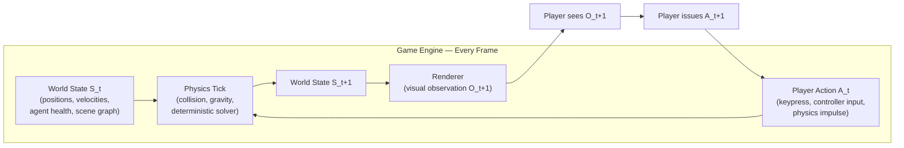
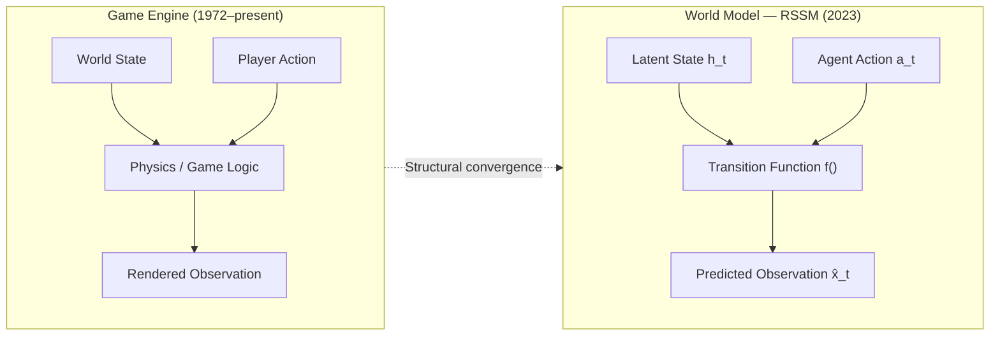
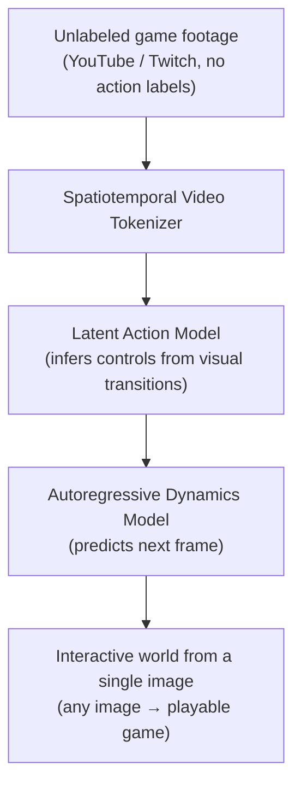
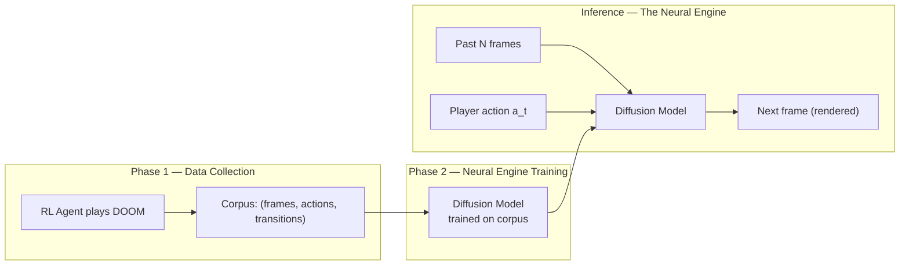

> **The World Model Series — Part 3 of 3**
>
> This is the *who built it*: game developers as the unwitting architects of Era 7.
> Start with [Part 1: Why World Models Had to Exist →](https://dev.to/ganesh_rajendran_art/why-world-models-had-to-exist-80-years-of-ai-trying-to-understand-reality-42nk)
> Then read [Part 2: The World Model Trilemma →](https://dev.to/ganesh_rajendran_art/the-world-model-trilemma-pixels-splats-and-symbolic-physics-59ci)

> **TL;DR:** If you've written a game loop, you've written a world model: state → action → next state → render. DreamerV3, VPT, Genie and GameNGen prove it's the same computation.

---

## The Punchline That Took 80 Years

Part 1 of this series traced every major AI paradigm since 1943 and showed that each one failed in the same direction: no model of reality. Symbolic AI hit the combinatorial wall. Expert systems couldn't encode knowledge fast enough. Deep learning achieved superhuman pattern recognition but had no concept of *what happens next*. Transformers, despite their scale, hallucinate because they predict tokens, not consequences.

Era 7 — World Models (my term from Part 1 for the world-model paradigm) — was the solution the field had been converging on for eight decades. The core idea: build an internal, predictive model of the environment that simulates future states and reasons causally about actions.

Here is the part that wasn't in Parts 1 or 2.

**Game developers had already built this. From Pong (1972) to Unreal Engine 5 (2022), they shipped it to consumers.**

The render loop. The physics tick. The state machine. The action-to-consequence pipeline. The agent behavior system. These are not *analogous* to world model components. They are, structurally and mathematically, the same thing. AI researchers spent 80 years trying to formalize what game engineers had been shipping to consumers since Pong.

This isn't a metaphor. It's an architectural convergence — and the evidence is in the papers.

---

## A Game Engine, Dissected

Before the comparison, let's be precise about what a game engine actually does.



Strip away the renderer and the player, and what remains is this:

> **Given world state `S_t` and agent action `A_t`, compute the next world state `S_{t+1}`.**

Now read the formal definition of a world model from the literature:

Hafner et al. define a world model in DreamerV3 (2023) as a system that maintains a compact representation of the environment and can predict the consequences of actions to support planning.

The notation in DreamerV3's Recurrent State Space Model (RSSM):

```
h_t = f(h_{t-1}, z_{t-1}, a_{t-1})       # recurrent state transition
z_t ~ q(z_t | h_t, x_t)                  # posterior representation
x̂_t ~ p(x_t | h_t, z_t)                 # observation reconstruction
r̂_t ~ p(r_t | h_t, z_t)                 # reward prediction
```

Where:
- `h_t` is the hidden (recurrent) state — the game engine's world state
- `a_{t-1}` is the previous action — the player's input
- `x̂_t` is the predicted observation — the renderer's output
- `r̂_t` is the predicted reward — the game's scoring function

**The game engine and the world model are the same computational graph.** One is hand-coded and deterministic, optimized for 60 FPS delivery to a human player. The other is learned and stochastic, trained from data. But the computational contract — state, action, transition, observation — is identical.



This is the mirror.

---

## The Evidence: Four Moments When AI Arrived Where Games Already Were

### 1. DreamerV3 (2023) — The Physics Testbed

**Hafner, D., Pasukonis, J., Ba, J., Lillicrap, T. *Mastering Diverse Domains through World Models.* arXiv:2301.04104**

DreamerV3 is not a game-playing system. It is a world model that happens to be validated *on* games because games are the only environments that offer:

- Exact, reproducible state transitions (deterministic physics)
- Action-conditioned observations at scale (every frame is a labeled training example)
- Diverse, structured curricula at zero marginal cost (level design as RL curriculum)

The result: a single architecture, with *identical hyperparameters*, achieved superhuman performance across **150+ tasks** — Atari arcade games, 3D open-world Minecraft, continuous control locomotion, and robotic arm manipulation. The first AI to collect diamonds in Minecraft from scratch, with no human demonstrations, no task-specific tuning.

The significance is not the diamond. It's that the model trained *entirely in imagination* — running forward inside its own RSSM world model, never touching the real game environment during training. DreamerV3 didn't play Minecraft. It simulated Minecraft inside itself and learned from that simulation.

That simulation only worked because Minecraft's physics — a hand-engineered deterministic system — gave the world model causally grounded training signal to begin with.

**Games didn't help DreamerV3 generalize. Games made generalization possible.**

---

### 2. VPT — Video PreTraining (OpenAI, 2022) — The Data Revelation

**Baker, B., et al. *Video PreTraining (VPT): Learning to Act by Watching Unlabeled Online Videos.* arXiv:2206.11795**

The question VPT answered: *what is the actual training material for a world model?*

The answer OpenAI arrived at: **contractor-recorded human gameplay**.

~2,000 hours of Minecraft footage, recorded by paid contractors with synchronized keyboard and mouse telemetry, trained an Inverse Dynamics Model (IDM). The IDM then pseudo-labeled ~70,000 hours of unlabeled YouTube Minecraft footage — inferring what the player must have pressed to produce each observed state transition.

The resulting VPT foundation model, fine-tuned with RL, could craft diamond tools — a sequential task requiring up to 24,000 precise actions in the right order (~20 minutes at the game's 20Hz tick).

What VPT established:

| Component | Game Equivalent | ML Equivalent |
|---|---|---|
| Input | Player keypress | Action label `a_t` |
| Output | Next game frame | Observation `x_{t+1}` |
| Label | Synchronized controller log | Action annotation |
| Dataset | Twitch / YouTube archive | Internet video corpus |

Passive internet video — the substrate of LLMs — encodes *what* happens. A game session encodes *what* happened *because of what the agent chose to do*. That `(observation, action, next_observation)` triple is causality in a training file.

Game studios had been generating this dataset, at 20–60 Hz, for every hour of human play, for decades. No one had thought of it as a commodity. VPT was the moment that changed.

---

### 3. Genie / Genie 2 (DeepMind, 2024) — The Reverse Engineer

**Bruce, J., et al. *Genie: Generative Interactive Environments.* arXiv:2402.15391**
**DeepMind (Dec 2024). *Genie 2: A large-scale foundation world model.***

Genie's finding is the most conceptually provocative of the four.

It trained an 11-billion-parameter system (across tokenizer + latent action model + dynamics model) on unlabeled internet video — predominantly 2D platformer game footage — with no action annotations at all. No synchronized controller logs. Just raw video.

The latent action model — one of Genie's three components — learned to *infer* what control scheme must have been in use by watching the visual consequences of actions across millions of clips. It reverse-engineered the game's input interface from the game's output.

Then it made any input image "playable."



What this means architecturally: Genie didn't need game developers to hand over their source code, their physics engine, or their action logs. It reconstructed the causal structure of the game — the implicit world model — from the visual record alone.

Genie 2 (December 2024) extended this to rich 3D interactive environments from a single prompt image: real-time physics, varied lighting, object interactions. Explicitly designed as a training curriculum generator for embodied agents — robotics, autonomous driving, digital assistants.

The pipeline that produced it: **game footage → latent action → interactive world.** That pipeline is now a first-class research primitive. And its upstream dependency is the game industry's art, level design, and physics implementations — most of it sitting in Twitch VOD archives, unmonetized.

---

### 4. GameNGen (Google Research, 2024) — The Replacement

**Valevski, D., et al. *Diffusion Models Are Real-Time Game Engines.* arXiv:2408.14837**

GameNGen is the bluntest demonstration of the mirror.

The researchers took DOOM — the 1993 id Software game, one of the most carefully engineered deterministic simulation logics ever written — and replaced it with a diffusion model. Not an approximation running alongside the engine. A replacement. The neural network *is* the engine.

Two-phase process:

1. An RL agent played DOOM, generating a corpus of `(frame, action, next_frame)` triples
2. A diffusion model trained on that corpus to predict the next frame given past frames and player action

The result ran at 20 FPS on a single TPU-v5 (20 FPS single-step, ~10 FPS autoregressive). Human raters, shown side-by-side clips, could barely distinguish the neural simulation from the real game. PSNR 29.4 dB — perceptually near-identical to source.



What GameNGen proved: a game engine — with its physics solver, renderer, state machine, and game logic — is **compressible into learned latent dynamics**. The hand-engineered simulation and the neural approximation converge on the same function.

The implications for the "AI rediscovered games" thesis are stark. DOOM's engine was John Carmack's explicit, hand-coded model of a simplified physical world: collision geometry, projectile trajectories, door state machines, enemy behavior trees. GameNGen learned all of it from observation.

The learned world model and the engineered game engine computed the same thing. One from equations. One from data.

---

## The Structural Convergence Table

Every core component of a modern world model has a named, shipped equivalent in game engine design. This isn't coincidence. It's the same computational problem, solved twice.

| World Model Component | Game Engine Equivalent | Example |
|---|---|---|
| Latent state `h_t` | World state / scene graph | Transform tree, entity positions, physics body state |
| State transition `f(h, a)` | Physics tick + game logic | Unity `FixedUpdate()`, Unreal `PhysicsStep()` |
| Observation model `p(x\|h)` | Renderer | Rasterizer, ray tracer, shader pipeline |
| Action space | Input system | Keymap, controller binding, action mapping |
| Reward function | Score / game objective | Points, health, win conditions |
| RL curriculum | Level design | Difficulty progression, procedural generation |
| Imagination rollout | Offline playtesting | Running the sim without a human player |
| World model training data | Gameplay recordings | Telemetry, Twitch VODs, QA session logs |

---

## Why It Took 80 Years to See This

If game engines were world models all along, why didn't the AI field recognize it?

Three reasons.

**First: disciplinary separation.** Game engineering and AI research developed in parallel communities with minimal cross-pollination. Game engineers optimized for 60 FPS interactive experience. AI researchers optimized for benchmark performance on standard datasets. Neither read the other's literature systematically.

**Second: the renderer was invisible.** Game engines produce *visual output* for humans. AI researchers saw the output — the game — not the underlying state machine that generated it. The world model is the physics tick, not the frame. Watching a game play didn't reveal the causal architecture underneath. DeepMind's DQN (2013) famously used Atari as a pixel benchmark but treated games as arrays of pixels to classify, not as causal worlds to model.

**Third: the data wasn't labeled the right way.** Game recordings existed in abundance — Twitch, YouTube, Steam. But they were filed under "entertainment," not "action-conditioned causal training corpora." VPT (2022) was the first system to explicitly treat gameplay recordings as the structured training data they always were.

The field arrived at world models through the mathematics of planning under uncertainty (Bellman, 1957), through neuroscience (predictive coding, Helmholtz), through robotics (model-based RL). It did not arrive there by looking at Unity source code. But when world model researchers needed a universal testbed — an environment that was physically grounded, action-conditioned, diverse, and infinitely scalable — they turned to games.

Games were waiting. Yet games are closed, resettable, and simplified. The real world is not. That simplification is exactly why games worked as curricula — and why the next leap is harder.

---

## The Philosophical Close: Simplified Reality by Design

There is something deeper here than a convergence of architectures.

Games have always been, at their most fundamental level, a *simplified model of reality designed for agents to act in*.

That is the definition of a world model.

When Will Wright built SimCity, he wasn't making a game. He was building a compressed, navigable, causally consistent model of urban dynamics — one where an agent (the mayor) could take actions, observe consequences, and learn. When id Software shipped Quake, the physics engine wasn't incidental to the game. The physics engine *was* the game — a simplified Newtonian world where the rules were explicit, the state was trackable, and causality was enforced at every tick.

Game designers have known, intuitively, what AI researchers formalized mathematically:

> An agent can only learn to act intelligently in a world it can predict.

They built predictable worlds. They called them games.

AI spent 80 years building systems that could pattern-match, classify, and generate — but couldn't predict. When it finally built systems that could predict — world models — it discovered that the best training environments for those systems were the predictable worlds game developers had been shipping for half a century.

The recursion is almost elegant. Games were designed so that humans could learn by acting in them. World models learned by acting in games. The student became the curriculum.

---

Era 7 didn't emerge from a lab in isolation. It emerged from the collision of two traditions that never knew they were working on the same problem.

Game developers built the world. AI learned to simulate it.

They were always building toward the same thing.

---

## Primary Sources

1. Hafner, D., Pasukonis, J., Ba, J., Lillicrap, T. (2023). *Mastering Diverse Domains through World Models (DreamerV3).* arXiv:2301.04104
2. Baker, B., et al. (2022). *Video PreTraining (VPT): Learning to Act by Watching Unlabeled Online Videos.* arXiv:2206.11795
3. Bruce, J., et al. (2024). *Genie: Generative Interactive Environments.* arXiv:2402.15391
4. Valevski, D., et al. (2024). *Diffusion Models Are Real-Time Game Engines (GameNGen).* arXiv:2408.14837
5. Google DeepMind (Dec 2024). *Genie 2: A large-scale foundation world model.* https://deepmind.google/discover/blog/genie-2-a-large-scale-foundation-world-model/
6. LeCun, Y. (2022). *A Path Towards Autonomous Machine Intelligence.* openreview.net/forum?id=BZ5a1r-kVsf
