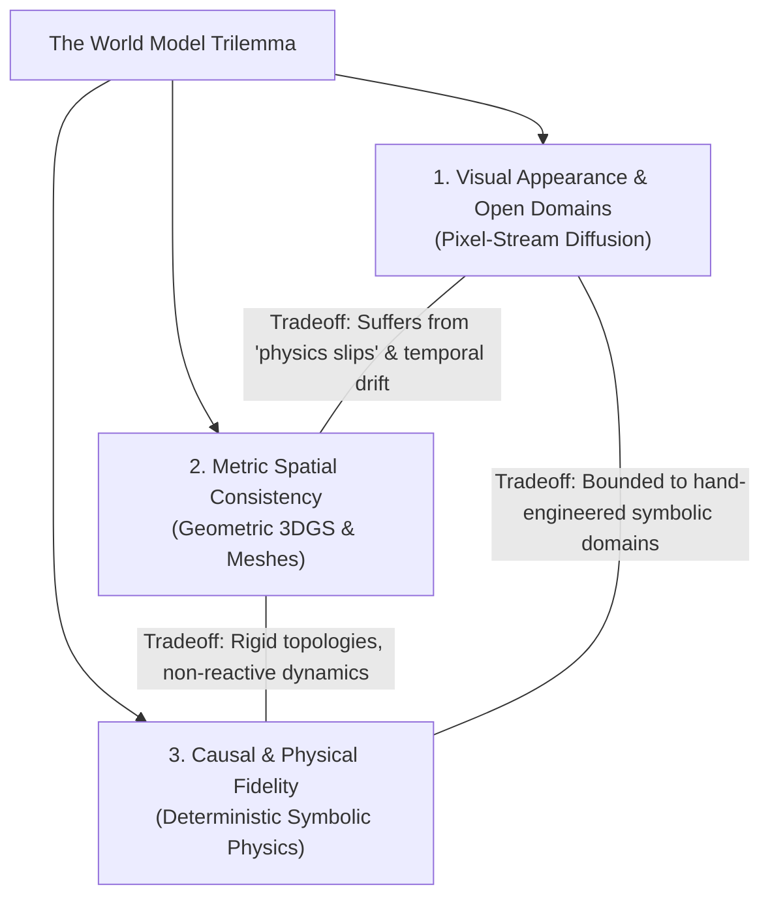
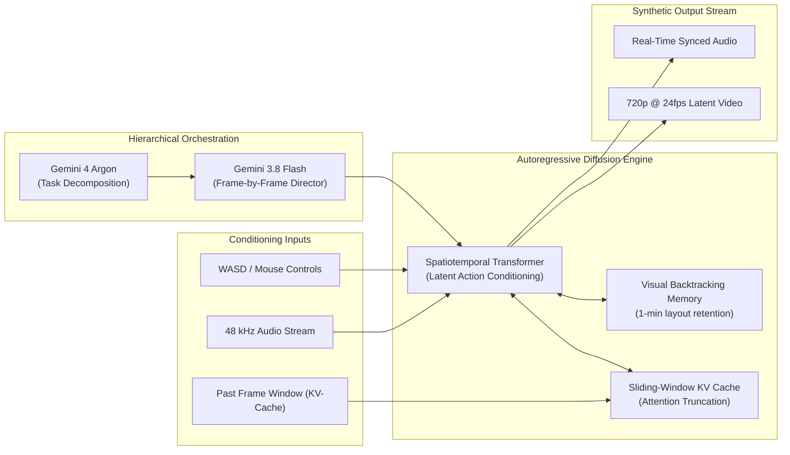
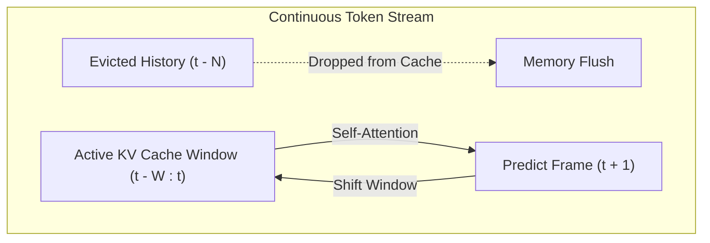
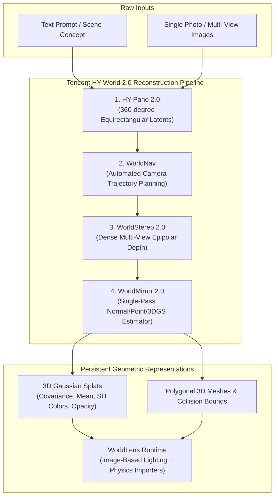
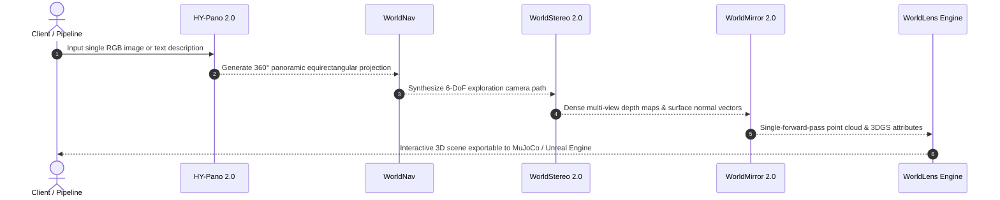
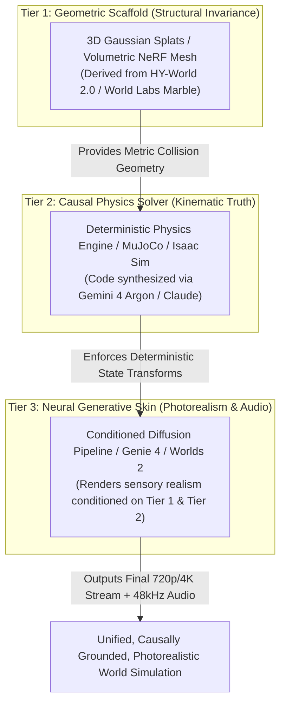

# The World Model Trilemma: Pixels, Splats, and Symbolic Physics

**A Systems Engineering Deconstruction of Google Genie 4, Runway GWM Worlds 2, World Labs Marble, Tencent HY-World 2.0, and Gemini 4 Argon + MuJoCo**

*By Systems & AI Research Engineering*

---

## 1. Introduction: The False Equivalence of "World Models"

The machine learning ecosystem has conflated three fundamentally incompatible definitions under the singular umbrella of "World Models."

When Google DeepMind announces **Genie 4** or Runway launches **GWM Worlds 2**, they define a world model as an *autoregressive, conditional video and audio diffusion pipeline* operating entirely in latent pixel space. When Fei-Fei Li’s World Labs introduces **Marble** or Tencent open-sources **HY-World 2.0**, they define a world model as an *immutable, geometrically grounded 3D coordinate space* discretized into 3D Gaussian Splats (3DGS) or polygonal meshes. Meanwhile, teams pursuing physical robotics—such as the engineers deploying DeepMind's **Gemini 4 Argon** with **MuJoCo**—define a world model as a *symbolic, causal state machine* governed by Newtonian equations of motion.

These paradigms do not represent incremental variations of the same underlying architecture. They represent three divergent vertices of what we term **The World Model Trilemma**:

1. **Pixel-Stream Diffusion**: Unbounded visual open-endedness and photorealism at the cost of geometric permanence and causal mechanics (hallucinated physics).
2. **Geometric 3D Representation**: Immutable multi-view metric consistency at the cost of dynamic, reactive interactions (static topologies).
3. **Hybrid Symbolic Simulation**: Provable physical correctness and deterministic verification at the cost of open-world semantic flexibility and visual scalability.

Current engineering practice forces a brutal compromise. No single model architecture satisfies all three properties simultaneously. This article examines the architectural mechanics, failure surfaces, and systems trade-offs of the leading implementations across each pillar.

---

## 2. Pillar I: The Pixel-Stream Paradigm (Diffusion & Autoregressive Video)

The pixel-stream approach frames world modeling as a conditional sequence modeling task: given past sensory observations $O_{1:t}$ and control actions $a_{1:t}$, model the distribution $P(O_{t+1} \mid O_{1:t}, a_{1:t})$ across visual and acoustic tokens.

### Architectural Lineage: From GameNGen to Genie 4

The mechanical foundation of interactive generative video evolved rapidly from toy 2D experiments to distributed, multi-modal neural engines:

- **[Genie 1 (February 2024)](https://arxiv.org/abs/2402.15391)** (Bruce et al., Google DeepMind): Introduced unsupervised *Latent Action Discovery*. By training a vector-quantized latent action model over 200,000+ hours of unlabeled gameplay footage, Genie discovered discrete control tokens $z_t \in \mathcal{Z}$ without telemetry or manual keylogging annotations. A spatiotemporal transformer then generated 2D platformer steps (~1 fps).
- **[GameNGen (August 2024)](https://arxiv.org/abs/2408.14837)** (Valevski et al., Google Research & Tel Aviv Univ): Proved that a pure neural diffusion model can simulate the DOOM engine at >20 fps on a single TPU. GameNGen replaced the fixed game loop, binary spatial partitions (BSP trees), and state machine with an autoregressive diffusion pipeline conditioned on target actions and previous frame sequences, stabilized against cascading error via strategic noise augmentation.
- **Genie 2 to Genie 3 (2024–2025)**: Transitioned from 2D pixel generation to 3D interactive camera movement (720p @ 24 fps). Genie 3 introduced *Visual Backtracking Memory*, explicitly training the transformer to retain spatial layout invariants when the camera turns 180 degrees away from an object and returns within a ~1-minute temporal horizon.
- **Genie 4 (October 2026)**: Scaled the context horizon to 2-minute continuous sessions and introduced tightly synchronized real-time environmental audio and dialogue. Crucially, Genie 4 abandoned the idea that a single model can act as renderer, game logic director, and physical engine simultaneously. It deployed a multi-model hybrid hierarchy:
  - **Generative Renderer**: Genie 4 + Gemini Omni for real-time visual-acoustic synthesis.
  - **Runtime Director**: **Gemini 3.8 Flash**, monitoring frame outputs at sub-second latency to verify temporal progression, inject mid-prompt event triggers, and correct semantic divergence.
  - **Task Reasoner**: **Gemini 4 Argon**, translating high-level policy instructions into sequential conditioning vectors.

### Runway GWM Worlds 2 & The Sliding KV-Cache

Runway's **GWM Worlds 2** (September 2026) diverged from Google's fixed-horizon clip architecture by designing an engine for indefinite generation. Rather than resetting context windows every 60–120 seconds, Worlds 2 implements a continuous **Sliding KV-Cache Attention** mechanism over its latent visual tokens:

To coordinate interaction across time, Worlds 2 structures state via an explicit **WorldPrompt Specification**, which formalizes input conditioning into distinct layers:

| Layer | Component | Payload & Functionality |
| :--- | :--- | :--- |
| **01** | `Persistent World Context` | Static embeddings defining art direction, environmental lighting constants, global physical heuristics, and the initial seed tensor $I_0$. |
| **02** | `Dynamic Camera Trajectory` | Continuous 6-DoF matrix stream $(x, y, z, \text{pitch}, \text{yaw}, \text{roll})$ mapped directly to camera extrinsic projections. |
| **03** | `Timestamped Action Events` | Discrete keyboard/mouse interrupts, discrete collision triggers, and text-based macro-directives (e.g., `"detonate charges at t=14.2s"`). |
| **04** | `Continuous Audio Ingest` | 48 kHz multi-channel waveform streaming conditioned symmetrically into the latent cross-attention blocks. |

### Failure Modes: Cascading Drift and "Physics Slips"

Despite 720p resolution and low latency, pixel-stream engines fail systematically in mission-critical applications:

1. **The Autoregressive Noise Cascade**: Every generated frame introduces $\epsilon_t \sim \mathcal{N}(0, \sigma^2)$ prediction variance. In a sliding-window KV cache, past hallucinations become future ground-truth conditioning. By frame 1,500 (~60 seconds at 24 fps), fine geometry (such as architectural corners, text signage, and small objects) undergoes topological morphing.
2. **Physics Slips**: Because the model learns statistical correlations between consecutive 2D projections rather than 3D mass, friction, and rigid body dynamics, objects routinely exhibit non-Newtonian failure modes:
   - Rigid containers deform elastically under light impact.
   - Occluded objects cease to exist once rotated out of frame if they exceed the visual backtracking window.
   - Elastic collisions violate conservation of momentum: billiard balls compress or vanish instead of transferring kinetic energy.
3. **Compute Scaling Asymmetry**: Generating 720p video at 24 fps in real time requires massive inference infrastructure (e.g., clusters of TPUs or Blackwell GPUs running FP8/INT4 speculative decoding). Rendering a single frame through a 20B+ parameter diffusion transformer is orders of magnitude more expensive than evaluating a classical game loop.

---

## 3. Pillar II: The Geometric 3D/4D Paradigm (3DGS & Scene Reconstruction)

Recognizing that pixel hallucination is an inevitable consequence of predicting 2D projections without an underlying coordinate frame, the second pillar—spearheaded by **World Labs (Marble)** and **Tencent (HY-World 2.0)**—grounds world simulation in metric 3D representations.

### World Labs Marble & Spatial Intelligence

Founded by Fei-Fei Li, Justin Johnson, and NeRF co-inventors Christoph Lassner and Ben Mildenhall, [World Labs](https://www.worldlabs.ai/) explicitly rejects pixel interpolation in favor of **Spatial Intelligence**. In September 2026, AMD announced its ~$8.2 billion all-stock acquisition of World Labs to anchor ROCm-native spatial computing.

World Labs' core engine, **Atlas**, is an omni-modal autoregressive diffusion transformer. Unlike video transformers that output consecutive latents, Atlas operates over a unified representation spanning:
- Volumetric density fields.
- 3D Gaussian distributions defined by centroids $\mu \in \mathbb{R}^3$, 3D covariance matrices $\Sigma$, view-dependent spherical harmonics (SH), and opacity $\alpha$.
- Explicit mesh topology $(V, F)$ with accompanying UV texture maps.

Because the underlying artifact is a static 3D coordinate space, camera motion does not introduce temporal drift. Revisiting a room after an hour of virtual traversal yields mathematically identical geometry because the points are anchored in an immutable spatial coordinate frame $(\mathbb{R}^3)$ rather than a transient KV-cache.

### Tencent HY-World 2.0: The Open-Weights Pipeline

While World Labs operates as a closed cloud API, Tencent open-sourced **HY-World 2.0** on Hugging Face (`tencent/HY-World-2.0`) and GitHub in April 2026 ([arXiv:2604.14268](https://arxiv.org/abs/2604.14268)). 

HY-World 2.0 decomposes scene generation into a modular, feed-forward deep learning pipeline:

The breakthrough of HY-World 2.0 lies in **WorldMirror 2.0**: rather than running slow iterative optimization per scene (as in classical 3DGS optimization, which takes 10–30 minutes per room), WorldMirror utilizes a feed-forward transformer that predicts depth maps, surface normal fields, camera extrinsics, and Gaussian splat parameters in a single forward pass.

### Failure Modes: Topological Rigidity and Non-Reactive Dynamics

While 3DGS and meshes resolve the camera drift and spatial hallucination problems completely, they hit a different wall:

1. **Frozen Worlds**: 3DGS represents a static visual snapshot. It does not possess a concept of time, kinematics, or state transformation. If an agent attempts to open a drawer, push a chair, or pour liquid, the splat representation lacks the underlying mechanical equations to model articulation or topological deformation.
2. **Reconstruction Artifacts at Epipolar Disocclusions**: In single-image-to-3D pipelines (HY-World 2.0), views occluded from the initial vantage point must be hallucinated by diffusion prior models (`WorldStereo`). If the prior predicts contradictory depth for the occluded zone, the resulting 3DGS output displays "floaters", blurs, or degenerate needle-like splats.
3. **Decoupled Lighting and Material Properties**: Standard 3DGS bakes illumination and specular reflections directly into spherical harmonic coefficients. Changing environmental illumination (e.g., turning off a light or casting a dynamic shadow) requires decomposing splats into intrinsic material properties (albedo, roughness, metalness), an inverse problem that remains computationally expensive and brittle.

---

## 4. Pillar III: The Hybrid Symbolic Paradigm (Neural Code Synthesis + Physics Engines)

For physical robotics, autonomous driving, and industrial automation, both pixel-stream diffusion and static 3DGS fail the strict verification thresholds required for real-world deployment. A robot cannot train its manipulation policy on video that hallucinates coffee mugs merging through tables.

This realization prompted Google DeepMind to deploy **Gemini 4 Argon** alongside **MuJoCo** (Multi-Joint dynamics with Contact), inaugurating the **Hybrid Symbolic Paradigm**.

```mermaid
flowchart LR
    subgraph Perception["Visual Ingest"]
        Photo["Real-World Workspace Photo / Scan"]
    end

    subgraph NeuralSynthesis["Symbolic Code Synthesis"]
        Argon["Gemini 4 Argon<br/>(Multi-Modal Code Synthesizer)"]
        MJCF["Executable MuJoCo XML (MJCF)<br/>- Kinematic Trees<br/>- Joint Actuators & Friction<br/>- Contact Solvers"]
        Argon -->|"Compiles Image to Code"| MJCF
    end

    subgraph DeterministicEngine["Physics Engine Execution"]
        Solver["MuJoCo Physics Solver<br/>(Rigid Body Dynamics & Equations of Motion)"]
        Episodes["4,500+ Synthesized Practice Episodes<br/>(Parallel CPU/GPU Threads)"]
        MJCF --> Solver
        Solver --> Episodes
    end

    subgraph PolicyTraining["Agent Policy Learning"]
        SIMA["SIMA / Robotics Policy<br/>(Continuous Action Space Optimization)"]
        RealDeploy["Physical Robot Hardware Deployment<br/>(Success Rate: 56% -> 75%)"]
        Episodes --> SIMA
        SIMA --> RealDeploy
    end

    Photo --> Argon
```

### The Mechanism: Image-to-Code vs. Image-to-Video

Instead of using a diffusion model to render what happens when a robot arm grasps an object, Gemini 4 Argon acts as a neural compiler:
1. **Geometric & Semantic Parsing**: Argon parses an input photograph of a tabletop workspace, identifying physical primitives (cubes, cylinders, articulated levers), surface friction coefficients, center-of-mass locations, and joint constraints.
2. **Deterministic Model Generation**: Argon emits a clean, fully formatted **MJCF (MuJoCo XML)** or **URDF (Unified Robot Description Format)** configuration file.
3. **Parallelized Execution**: The synthesized MJCF is loaded into thousands of headless MuJoCo environments running at 10,000+ simulation steps per second on standard CPU/GPU compute nodes.
4. **Causal Exploration**: In this environment, collisions obey analytical dynamics equations:
   $$\mathbf{M}(q)\ddot{q} + \mathbf{c}(q, \dot{q}) = \tau + \mathbf{J}(q)^T f_{\text{contact}}$$
   Failures are physically accurate: an unstable grasp results in an object slipping from the gripper due to frictional forces, rather than dissolving into latent noise.

In production trials, DeepMind demonstrated that generating 4,500+ randomized MuJoCo practice episodes from a single workspace photo raised physical robot manipulation success rates from **56% to 75%** on complex real-world multi-object sorting and assembly tasks.

### SIMA and Waymo: Scaling Multi-Agent Policy Transfer

- **[SIMA (Scalable Instructable Multiworld Agent)](https://arxiv.org/abs/2404.10132)** (SIMA Team, Google DeepMind): Evaluates language-guided agents across diverse 3D environments. Because SIMA maps natural language commands directly to continuous action controls $(a_t)$, it leverages deterministic simulation boundaries to verify whether an action achieved its precondition-postcondition invariants.
- **Waymo World Model**: Autonomous driving requires testing for tail-risk events (e.g., a child running out from behind a parked vehicle during a sudden hailstorm). Pure pixel diffusion generates uncalibrated LiDAR point clouds; pure game engines lack realistic photic glare. Waymo’s hybrid model synchronizes a generative diffusion layer on top of a deterministic 3D vehicle dynamics and sensor simulation loop, preventing the hallucination of non-physical trajectory accelerations.

### Failure Modes: The Symbolic Expressivity Bottleneck

The hybrid symbolic approach provides mathematical guarantees at the expense of generalizability:

1. **The Representation Gap**: MuJoCo and Isaac Sim excel at rigid bodies, articulated kinematic chains, and basic contact manifolds. They struggle catastrophically with cloth, deformable soft bodies, tearing fabrics, fluid dynamics, granular media (e.g., pouring rice or sand), and non-rigid vegetation.
2. **Compiler Hallucination**: If Gemini 4 Argon misestimates the mass density of an ambiguous plastic object from a single photo by a factor of three, the resulting simulation will execute with mathematical precision, but transfer to the physical robot will fail due to inaccurate inertia matrices.
3. **High Engineering Friction**: Unlike a pixel-stream model that ingests raw video and outputs raw video with zero manual configuration, symbolic compilation requires maintenance of joint limits, collision geometry meshes, and complex solver tuning to prevent numerical divergence.

---

## 5. Comprehensive Architectural Comparison

The following matrix benchmarks the four landmark world models across their systems architecture, hardware demands, failure modes, and licensing availability:

| Technical Vector | Runway GWM Worlds 2 | Google Genie 4 | World Labs Marble | Tencent HY-World 2.0 | Gemini 4 Argon + MuJoCo |
| :--- | :--- | :--- | :--- | :--- | :--- |
| **Model Category** | Generative Latent Video | Multi-Model Video + LLM Director | Spatial Intelligence Foundation | Modular Scene Reconstruction | Neural Code Synthesis + Physics Engine |
| **Primary Representation** | 720p @ 24fps Continuous Latent Stream | 720p @ 24fps Latent Stream + Audio | 3D Gaussian Splats & Polygons | 3DGS, Point Clouds & Normals | MJCF / URDF Executable Code |
| **Temporal Horizon** | Indefinite (Sliding KV-Cache) | Up to 120s (Consistency drift near limit) | Static Persistent Coordinate Frame | Static Persistent Coordinate Frame | Indefinite (Bounded by simulation clock) |
| **Audio Synthesis** | Real-time synced 48 kHz multi-channel | Real-time synced 48 kHz audio & dialogue | None (Purely spatial/geometric) | None (Purely spatial/geometric) | None (Synthesized externally if needed) |
| **Interaction Latency** | Sub-second real-time interactive | Sub-second WASD + text steerability | Free 6-DoF camera navigation | Real-time navigation (WorldLens) | Microsecond physics tick; rendering separate |
| **Dominant Failure Mode** | Progressive semantic drift; physics slips | Visual backtracking drift; hallucinations | Inability to model dynamic topology | Occlusion artifacts; fixed illumination | Fails on fluids, deformables, cloth |
| **Sim2Real Transfer Value** | Policy correlation (Praxis-1 tabletop) | Visual imitation learning playground | 3D spatial priors & geometry grounding | Asset export to Unreal/Unity/Isaac | Provable Newtonian causal fidelity |
| **Inference Hardware Target** | Cloud GPU cluster (Inference streaming) | High-end Cloud TPU/GPU infrastructure | Cloud spatial rendering infrastructure | Consumer GPUs / Workstations | Standard CPU/GPU clusters (High throughput) |
| **Weights Availability** | Closed Research Preview | Closed Research Preview | Proprietary Cloud Platform | **Open Weights (Hugging Face)** | Closed Gemini API; Open MuJoCo Core |

---

## 6. Synthesis: The Emergent Convergent Architecture

Can the Trilemma be solved?

The trajectory of research in late 2026 indicates that monolithic models will not solve all three vertices. Instead, production world models are actively converging into a **Three-Tier Decoupled Architecture**:

### How the Tiers Cooperate
1. **Tier 1 (The Spatial Anchor)**: Before any interactive rollout begins, a feed-forward model like **WorldMirror** or **Atlas** scans the environment, establishing a metric 3DGS coordinate frame. This eliminates camera drift: when a user or robot turns around, the spatial anchors are pinned to world space coordinates.
2. **Tier 2 (The Causal Arbiter)**: When an agent interacts with an object, the interaction is not predicted by next-frame pixel diffusion. Instead, an analytical physics solver (MuJoCo) calculates the forces, contacts, joint constraints, and trajectories deterministically.
3. **Tier 3 (The Generative Skin)**: An autoregressive diffusion renderer (Genie 4 or Worlds 2) takes the low-resolution or wireframe output from Tier 1 and Tier 2 and acts strictly as a neural shader. It provides high-frequency surface textures, fluid specular reflections, lighting variations, and synced environmental audio—*without having to compute the underlying physics*.

### Open Research Problems for Systems Engineers

For ML systems engineers building in this domain, three foundational engineering bottlenecks remain unresolved:

1. **Differentiable Coupling of 3DGS to Collision Solvers**: Currently, converting a 3D Gaussian cloud into a discrete collision mesh for MuJoCo is a discontinuous, heuristic-heavy pipeline. Real-time, fully differentiable conversion from Gaussian ellipsoids to signed distance fields (SDFs) with analytic contact normals is required.
2. **KV-Cache Attention Truncation without Semantic Loss**: In sliding-cache video models (Runway Worlds 2), deciding which historical attention keys to evict without losing track of objects that left the camera frustum 30 seconds ago is an unsolved caching challenge. Hybrid architectures blending state-space models (Mamba/Hyena) with sparse attention matrices are an urgent area of exploration.
3. **Unified Latent Control Spaces**: The industry lacks a standardized protocol for steering world models. While Runway uses its proprietary `WorldPrompt` schema and DeepMind relies on latent action tokens, the robotics ecosystem desperately requires an open, vendor-neutral interface—a *POSIX for World Models*—that standardizes camera trajectories, joint forces, spatial audio coordinates, and physical interrupts across disparate neural backends.

Until these boundaries are formalized, engineers must choose their compromises deliberately: accept visual drift for infinite exploration, accept frozen geometry for metric consistency, or accept rigid symbolic domains for physical truth. The art of world modeling in 2026 is not picking the single best model, but engineering the right connective tissue between all three.

---

## References

1. **Ha, D., & Schmidhuber, J. (2018).** "World Models." *NeurIPS '18*. [arXiv:1803.10122](https://arxiv.org/abs/1803.10122)
2. **Bruce, J., et al. (Google DeepMind, 2024).** "Genie: Generative Interactive Environments." *ICML '24*. [arXiv:2402.15391](https://arxiv.org/abs/2402.15391)
3. **Valevski, D., et al. (Google Research & Tel Aviv Univ, 2024).** "Diffusion Models Are Real-Time Game Engines." [arXiv:2408.14837](https://arxiv.org/abs/2408.14837)
4. **SIMA Team (Google DeepMind, 2024).** "Scaling Instructable Agents Across Diverse 3D Worlds." [arXiv:2404.10132](https://arxiv.org/abs/2404.10132)
5. **Kerbl, B., et al. (2023).** "3D Gaussian Splatting for Real-Time Radiance Field Rendering." *ACM Transactions on Graphics (SIGGRAPH)*, 42(4). [Inria Project Page](https://repo-sam.inria.fr/fungraph/3d-gaussian-splatting/)
6. **Tencent Hunyuan Team (2026).** "HY-World 2.0: A Multi-Modal World Model for Reconstructing, Generating, and Simulating 3D Worlds." [arXiv:2604.14268](https://arxiv.org/abs/2604.14268) | [Hugging Face Repository](https://huggingface.co/tencent/HY-World-2.0)
7. **Todorov, E., Erez, T., & Tassa, Y. (2012).** "MuJoCo: A physics engine for model-based control." *IEEE/RSJ IROS*. [doi:10.1109/IROS.2012.6386109](https://doi.org/10.1109/IROS.2012.6386109) | [mujoco.org](https://mujoco.org/)
8. **Runway Research (2024–2026).** "Introducing General World Models (GWM) & Worlds 2." [RunwayML Research](https://runwayml.com/research/introducing-general-world-models)
9. **World Labs (2024–2026).** "Spatial Intelligence: Large World Models with Persistent 3D Representation." [worldlabs.ai](https://www.worldlabs.ai/)
10. **Google DeepMind (2024–2026).** "Genie 2 & Foundation World Models for Interactive Simulation." [DeepMind Research](https://deepmind.google/discover/blog/genie-2-a-large-scale-foundation-world-model/)
