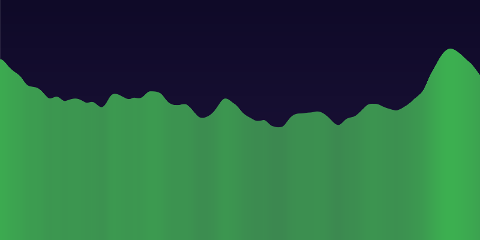

# The Invisible Brush — Generative Art & Algorithms That Paint

Generative landscape generator built with Clojure and [Quil](http://quil.info/) (Processing wrapper), based on the article [The Invisible Brush: Generative Art and the Algorithms That Paint](https://dev.to/ganesh_rajendran_art/the-invisible-brush-generative-art-and-the-algorithms-that-paint-32ig) 

The sketch computes an organic, scrolling terrain cross-section on demand from 1D Perlin noise across space and time coordinates, rendered under an interpolated dusk sky gradient.



## Core Techniques

- **Perlin Noise (`q/noise`):** Coherent pseudo-random function driving terrain contours.
- **Elevation-Aware Palette:** Vertical column rendering mapped dynamically by elevation (`q/map-range`).
- **Gradient Sky:** Continuous color interpolation (`q/lerp`) from deep indigo to dark slate.
- **Fractal Noise / Octaves:** Layered multi-frequency harmonics for fine-grained rock textures and broad contours.
- **Functional Architecture (`m/fun-mode`):** Pure functional state pipeline (`initial-state` → `update-state` → `draw-state`).

## Project Structure

```
├── deps.edn                     # Clojure CLI configuration & aliases
├── src/
│   └── generative/
│       └── terrain.clj          # Terrain generation logic & Quil sketch
├── test/
│   └── generative/
│       ├── terrain_test.clj     # Unit tests for height bounds & state flow
│       └── test_runner.clj      # CLI test runner
├── terrain.png                  # Sample rendered frame
└── README.md
```

## Getting Started

### Prerequisites

- Clojure CLI (`clojure`)
- Java 17+ (e.g. OpenJDK / Temurin)
- Graphical display server (X11 / Wayland) for live GUI rendering

## Running with Display ON (Interactive GUI)

To open the live, animated 60 FPS graphical window:

### 1. Verify your Display Environment

Ensure your display server socket is available:

```bash
echo $DISPLAY
```

In standard Linux and ChromeOS Crostini environments, this outputs `:0` (or `:1` for low-density / secondary screens).

If empty (e.g. inside tmux, screen, or subshells), export it:

```bash
export DISPLAY=:0
```

> **Note for SSH sessions:** Connect with X11 forwarding enabled (`ssh -X user@host` or `ssh -Y user@host`).

### 2. Launch the Application

Run using either the `:run` alias or namespace directly:

```bash
# Using deps.edn alias
DISPLAY=:0 clojure -M:run

# Or via namespace
DISPLAY=:0 clojure -M -m generative.terrain
```

A window titled **"Perlin Terrain"** (800x400) will appear showing the continuously scrolling landscape. Close the window or press `Ctrl+C` in your terminal to exit.

### 3. Live REPL Coding (Display Stays Open)

You can keep the window open while altering parameters on the fly without restarting the JVM:

```bash
# Start a REPL
DISPLAY=:0 clojure -M:run
```

In your editor or REPL:
1. Load the namespace: `(require '[generative.terrain :as t] :reload)`
2. Tweak noise scale or sky colors in `src/generative/terrain.clj`.
3. Re-evaluate `(t/run-sketch)` — the active canvas updates instantly.

---

## Offline & Headless Modes

### Snapshot Render (Headless / Automated)

Render a single frame directly to disk without keeping an interactive window open:

```bash
DISPLAY=:0 clojure -M -m generative.terrain --snapshot terrain.png
```

### Unit Tests (Zero Display Required)

Run the full assertion suite without any X11/Wayland display:

```bash
clojure -M:test
```

## Parameter Guide

Tune the generative parameters inside [src/generative/terrain.clj](src/generative/terrain.clj) to explore different landscape aesthetics:

| Parameter   | Default | Effect of Increasing                     |
|-------------|---------|------------------------------------------|
| `x-scale`   | `0.008` | More jagged, craggy terrain              |
| `time step` | `0.005` | Faster scrolling animation               |
| `amplitude` | `0.5`   | Taller mountain peaks                    |
| `base`      | `0.4`   | Shifts terrain baseline higher on canvas |
